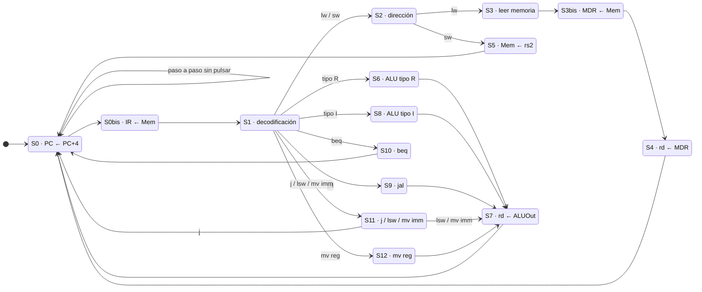

# Procesador RISC-V multiciclo en FPGA (Basys 3)


-orange>)


Procesador **RISC-V multiciclo** descrito en VHDL y ejecutándose en una placa **Digilent Basys 3** (Xilinx Artix-7). El repertorio base se ha ampliado con **tres instrucciones nuevas** (`j`, `lsw` y `mv`), cada una en su propia variante del diseño. Las tres variantes se verifican automáticamente con **GHDL** en cada *push* mediante GitHub Actions.

Práctica final de la asignatura *Tecnología y Organización de Computadores*.

---

## Características

- Ruta de datos multiciclo con memoria unificada de instrucciones y datos (BRAM de 512 × 32 bits).
- Unidad de control implementada como máquina de estados (FSM).
- Reloj de 10 MHz generado con el Clocking Wizard a partir de los 100 MHz de la placa.
- **Modo paso a paso**: un switch selecciona entre ejecución continua o instrucción a instrucción con un botón (con eliminador de rebotes).
- Los displays de 7 segmentos muestran el registro `x12` (`a2`) y el contador de programa.

### Repertorio base

| Tipo    | Instrucciones                              |
| ------- | ------------------------------------------ |
| R       | `add`, `sub`, `slt`, `and`, `or` |
| I       | `addi`, `slti`, `andi`, `ori`      |
| Memoria | `lw`, `sw`                             |
| Saltos  | `beq`, `jal`                           |

### Instrucciones añadidas

| Variante | Instrucción    | Opcode      | Semántica                                                                               |
| -------- | --------------- | ----------- | ---------------------------------------------------------------------------------------- |
| `j`    | `j imm`       | `0000010` | `PC ← imm` (salto absoluto, inmediato de tipo J sin signo)                            |
| `lsw`  | `lsw rd, imm` | `0010001` | `rd ← SW[7:4]` si `imm = 0`, `rd ← SW[3:0]` si no (lee los switches de la placa) |
| `mv`   | `mv rd, imm`  | `0010000` | `rd ← imm`                                                                            |
| `mv`   | `mv rd, rs1`  | `0010010` | `rd ← rs1`                                                                            |

Para `lsw` se añadió a la ruta de datos un multiplexor delante del registro `ALUOut` que permite cargar el valor de los switches y una señal de control nueva (`ALUOUTsrc`).

---

## Unidad de control

Las lecturas de la BRAM son síncronas y tardan un ciclo, por eso hay un estado extra en la búsqueda de instrucción (`S0bis`) y en la lectura de datos (`S3bis`).



---

## Programa de prueba

Cada variante carga en la BRAM un programa que multiplica dos números mediante sumas sucesivas y deja el resultado en `x12`.

En la variante `j` los saltos del bucle usan la nueva instrucción:

```asm
0x00  andi a2, a2, 0       # a2 = 0
0x04  lw   a0, 36(zero)    # a0 = 7
0x08  lw   a1, 40(zero)    # a1 = 3
0x0C  beq  a1, zero, 16    # si a1 == 0, salir del bucle
0x10  add  a2, a2, a0      # a2 += a0
0x14  addi a1, a1, -1      # a1--
0x18  j    12              # volver a 0x0C
0x1C  sw   a2, 44(zero)    # guardar el resultado
0x20  j    32              # fin (bucle infinito)
```

En la variante `lsw` los operandos se leen de los switches.

En la variante `mv` se usan `mv a3, 0` y `mv a2, a3`.

---

## Simulación

Hace falta [GHDL](https://github.com/ghdl/ghdl) ≥ 4.0.

Los testbenches comprueban solos el resultado y devuelven un error si no es el esperado:

```bash
bash sim/run_sim.sh j      # o lsw, mv
```

```text
sim/tb_riscv_lsw.vhd:59:25:@30050ns:(report note): OK: 7 * 3 = 21
sim/tb_riscv_lsw.vhd:59:25:@60100ns:(report note): OK: 5 * 10 = 50
```

La forma de onda se guarda en `build/<variante>/*.ghw` y se puede abrir con GTKWave.

Para simular sin Vivado, `sim/clk_100Mhz_to_10Mhz_sim.vhd` sustituye al IP de reloj de Xilinx.

---

## Síntesis y uso en la placa

Con Vivado 2023.1, desde la raíz del repositorio:

```bash
vivado -mode batch -source scripts/create_project.tcl -tclargs j bit
```

Esto crea el proyecto en `build/vivado_j/` y genera el bitstream. Si no se pasa `bit`, solo se crea el proyecto para abrirlo en la interfaz gráfica.

| Control          | Pin | Función                                              |
| ---------------- | --- | ----------------------------------------------------- |
| `SW15`         | R2  | Modo: `0` = continuo, `1` = paso a paso           |
| `BTNC`         | U18 | Ejecutar la siguiente instrucción (modo paso a paso) |
| `BTNL`         | W19 | Reset                                                 |
| `SW7`–`SW0` | —  | Operandos de `lsw` (solo en esa variante)           |
| Display 3        | —  | Índice de instrucción (`PC[5:2]`)                 |
| Displays 1–0    | —  | Byte bajo de `x12` en hexadecimal                   |

---

## Estructura

```text
rtl/common/     Componentes compartidos: ALU, banco de registros, memoria, displays...
rtl/j/          Variante con la instrucción j
rtl/lsw/        Variante con la instrucción lsw
rtl/mv/         Variante con las instrucciones mv
constraints/    Pines de la Basys 3 (basys3_lsw.xdc añade los switches)
ip/             Clocking Wizard 100 MHz → 10 MHz
sim/            Testbenches autoverificables y script de GHDL
scripts/        Creación del proyecto de Vivado
```

Cada variante contiene su ruta de datos, su unidad de control, su extensión de signo y su programa (`BlockRam.vhd`).

---

## Licencia

Distribuido bajo la licencia MIT. Consulta el fichero [LICENSE](LICENSE).
